# 基于感官观测重建、互补化合物筛选与风险约束生成的啤酒风味建模

> **论文正文逐节初稿 v3**。依据最终封闭实验报告改写；尚需参赛队核对化学解释、图表和独立核心工作。此文件不是提交终稿。

## 摘要

针对啤酒化学测量与感官评分在尺度、重复观测和解释口径上的差异，研究感官评分预测、关键化合物筛选以及风格条件生成与受约束迁移三个问题。对官方附件进行字段核验，并引入原研究公开的2197条逐评分员记录，将250款啤酒的重复品评先在评分员内聚合，再按评分员等权形成0—6分参考目标。对化学数据的部分对数尺度、缺失和最低值集中堆积分别建立可追溯的处理规则，统一采用啤酒级隔离的内部验证协议。

问题一比较传统回归、树集成与层次化神经网络。ExtraTrees在两次三折内部交叉验证中取得50维MAE 0.4454、RMSE 0.6305，优于所比较的层次网络；预设的训练内模型选择流程MAE为0.4521。输出整数分级时，将连续面板均分与单个评分员的离散评分加以区分。问题二围绕高度共线的化学特征，对Spearman前三、2+1条件增益、完整前向和冗余控制四种筛选规则进行统一比较。固定2+1规则的内部交叉验证MAE为0.4988，训练内选择整套流程的外层MAE为0.5024，最终提供50个感官维度对应的150项候选化合物及其Bootstrap稳定性。

问题三比较PCA高斯、独立Copula、联合Copula和条件变分自编码器，以分风格切片Wasserstein距离、联合低端结构、相关保真和生成多样性检验生成谱。CVAE取得较低的条件SWD 0.7059，但生成多样性较低；联合Copula在可估计风格中的相关结构误差为0.4508，低于独立Copula的0.4669。针对9款Pils来源啤酒实施Tripel迁移，比较无约束、点约束、不确定性约束与拒绝策略。点约束的独立目标风格诊断收益为0.0514，但仍有5款在独立stale_hops代理下出现上升；不确定性约束拒绝2款后仍有4款上升。

研究表明，恢复真实观测目标、区分固定筛选与完整选择流程、隔离生成设计器和评价器，有助于使预测、解释与生成结果可复核。所有报告结果均为同一批250款啤酒的内部重采样证据，尚不等于外部风格盲评或真实酿造验证。

**关键词**：感官面板；评分员等权；条件增益；共表达网络；Copula；风险约束迁移

# 一、问题重述

## 1.1 研究背景与数据条件

啤酒的感官特征与多种挥发性、非挥发性成分及理化条件共同相关。酵母代谢形成的酯类和高级醇、酒花来源的萜类、麦芽相关化合物，以及储存和氧化过程中的特征物质，均可能伴随香气、风味与缺陷感受的变化。然而，化学测量只是风味评价的一个信息来源。同一种化合物可能与多个感官属性相关，多种化合物也可能同时反映相似的发酵条件，因而不能将相关系数直接解释为独立因果作用。

本题提供啤酒化学测量、感官评分及风格标签。题面描述226款啤酒，实际附件包含250款，化学测量与理化特征共231项，感官汇总字段50项，细分风格22种。各风格样本量差异较大，少数风格只有数款样本。另由原研究公开版本获得2197条逐评分员品评记录，这使0—6等级的实测参考值可以构建，但也带来了重复品评、评分员权重以及汇总字段异常等问题。以上差异直接决定本研究的监督目标与评价方法。

## 1.2 竞赛任务与交付要求

第一问要求根据化学测量预测Aroma和Flavour评分卡中的0—6等级。官方评分卡定义了父类强度和细分属性的关系，官方汇总感官文件则是标准化连续值，不能直接把其负值舍入为等级。因此需要先明确监督目标，再训练模型并给出符合评分规则的分级结果。

第二问要求借助化合物相关性构建共表达图，为每个感官维度提供Top-3关键关联化合物。评价不能停留在单次相关排名，还需给出重采样稳定性、化学名称映射、风格相关性和候选之间的信息冗余。最终交付为50个维度的150条候选因素及相关证据。

第三问要求按啤酒风格生成合理的231维化学测量谱，并给出对应感官画像；进一步以Pils/Lager向Tripel迁移为代表，讨论风格目标与指定缺陷指标之间的约束关系。这里生成的是统计测量空间中的候选谱，其实际可酿造性仍需后续实物验证。

## 1.3 本文研究思路

本文先开展数据审计与感官观测重建，使三问使用的字段、单位和标签含义一致；再在严格隔离的内部验证中比较感官预测模型，保留表现稳定的基线；随后识别具有互补预测信息的候选化合物，并区分单一分子的排序与高相关替代组的稳定性；最后比较不同风格条件生成模型，以独立评价器复核风格迁移的收益和缺陷风险。图1展示数据、模型、验证与交付物之间的关系。

【图1：三问统一技术路线图，占位；数据源为`configs/rebuild_protocol.json`、`configs/closed_final_protocol.json`。】

# 二、模型假设、建模约定与符号说明

## 2.1 数据匹配与观测假设

**假设1：匿名序号与化学附件的物理行序对应。** 原论文公开数据的`beer_name=1,…,250`按行序连接官方化学附件，而不按附件中的`beer`数值连接。正确连接后与官方标准化感官文件的逐维相关中位数为0.9777，错误按同名整数连接的相关中位数仅0.0076。前者为映射提供一致性证据，但不能替代对原作者匿名化说明的人工核实。

**假设2：评分卡父子规则反映单条品评的编码方式。** 对24个细分字段，单条记录中的细分分数为所属父项分数或零。因此父项均分不小于细分均分。父项等于零时，无法仅凭细分零分判断评分员是否选中该属性；涉及出现概率的条件模型必须考虑这一点。

**假设3：大量重复最低值是观察编码中的点质量。** 该现象可能与检测限、预处理或仪器记录有关，但本数据未为全部变量提供可核验的LOD。本文仅拟合观测最低值堆积，并不推断低于最低值的真实化学浓度。

## 2.2 建模约定与适用范围

为避免评分员重复次数改变酒样权重，本文先对同一啤酒—评分员的重复记录求均值，再对评分员等权平均，定义啤酒层面的参考目标。缺失化学值由当前训练折中位数填补，任何标准化、特征筛选和超参选择均限制在训练角色内。对于样本很少的风格，条件生成模型适度借用总体边际信息，这是降低估计方差的模型选择，并不意味着各风格真实分布相同。上述约定均通过敏感性或消融分析讨论其影响。

## 2.3 主要符号

| 符号 | 定义 |
|---|---|
| $x_i\in\mathbb{R}^{231}$ | 第$i$款啤酒的附件编码化学谱 |
| $s_i$ | 啤酒细分风格标签 |
| $y_{irtj}$ | 第$i$款酒、第$r$位评分员、第$t$次品评在维度$j$的评分 |
| $\bar y_{ij}$ | 先评分员内、再评分员间等权聚合的面板均分 |
| $\widehat y_{ij},\;\widehat g_{ij}$ | 连续预测值及其0—6整数等级 |
| $Z,t$ | Q2训练折中标准化的秩特征矩阵与目标秩向量 |
| $S,G_j$ | 已选化合物集合与候选$j$的正则条件增益 |
| $\widehat F_{j,s}$ | 风格$s$下化合物$j$的估计边际分布 |
| $w_s$ | 风格样本量决定的经验边际权重 |
| $J(x')$ | 迁移候选谱$x'$的目标风格与改动成本 |

其中，$i$始终代表啤酒而非逐评分记录。模型误差与区间估计按啤酒汇总。

# 三、问题分析

## 3.1 第一问：从感官评分的观测机制确定预测对象

第一问首先要解决“0—6评分究竟指什么”。单个评分员的原始分值为整数；同一款酒由不同评分员评价后形成的均分通常为连续值；为交付评分卡而把均分四舍五入，则得到另一个整数等级。三者所包含的随机性和评价含义不同。由于一个啤酒可能出现重复品评，若把2197条记录直接当作2197个独立样本，会使部分啤酒得到更高权重，并可能使同酒记录跨越训练与验证角色。

因此，先构建等权面板监督目标，再按啤酒划分交叉验证。对模型机制，评分卡层次为结构网络提供了可检验动机，但共同叶节点预测的多输出树同样可能自动遵守父子不等式。是否采用层次神经网络，由它与ExtraTrees等强基线的实际误差决定。

## 3.2 第二问：从相关性排名到互补信息筛选

简单的Spearman Top-3排名可识别与感官同时变化的化合物，但多个入选化合物若高度相关，可能重复解释相同的风格或酿造过程。直接追求最低预测误差又可能造成低样本下排名不稳定。因此，第二问需要同时报告稀疏预测能力、三项之间的冗余、单化合物重抽样频率以及可替代化合物群的稳定性。

采用四种预设规则比较，并将规则本身的选择置于训练折内部。这一设计使模型选择的代价被纳入外层评价，防止只报告事后表现最好的固定方法。共表达图保留相关符号，用于解释化合物的结构关系，但全样本图不进入外层预测模型。

## 3.3 第三问：从化学谱分布到风险约束的迁移决策

第三问的231维输入与250个样本呈现高维小样本特征，且22种风格极不均衡。部分化合物在大量啤酒中共享相同的最低观测值，使连续正态假设难以表示真实记录分布。由此，模型需要同时处理风格条件、边缘低端质量和变量之间的联合依赖；单一距离指标可能奖励均值附近的低多样性结果。

迁移任务还有一个独立问题：用于筛选迁移候选的感官代理可能存在误差。如果让它同时证明缺陷没有恶化，评价将构成自我验证。因此本研究固定未参与候选优化的评价器，并同时报告风格收益、化学改变量、独立代理风险与拒绝率。

## 3.4 总体技术路线

统一流程为：原始附件及公开逐评分员记录→名称/尺度/评分机制审计→Q1面板评分预测→Q2化合物有符号网络与互补选择→Q3条件生成和受约束迁移→内部重采样及独立评价器复核→评分表、50×3候选、生成谱和迁移审计。所有训练与评价均按同款啤酒隔离，三问的统计结论只在当前内部验证协议下成立。

【图1：总技术路线图放置于此，第一章仅文字交叉引用，不重复绘制。】

# 四、数据审计与预处理

本轮以原始附件和新公开的逐评分员文件为输入，旧代码及网页端结果只用于问题定位。原始文件 SHA-256 清单在 outputs/rebuild/audit/raw_manifest.csv；新文件来源为原作者 Zenodo v4 [2]，MD5 为 a8f911d8c0061e096abf3b087678e164，与本地文件一致。全样本既往已被检查，因此本轮所有划分均属于内部重采样验证，不能称为从未接触过的外部测试。

## 4.1 数据概况与真实字段结构

1.csv 实际为 250 款啤酒、231 项化学或理化特征；4.csv 为 50 项感官目标；22 种风格中 Faro 仅 3 款，Tripel 为 28 款。题面中的“226 种啤酒”与实物不符。231 列包含物理测量和聚合量，不能全部称为单一化合物。1、4、7 按唯一 beer 对齐；beer_id 存在精度损失，不作主键。原始逐评分员文件中的 beer_name 是附件物理行序 1—250，不是附件 beer 编号；Beer 是品评位置，不能作啤酒键。正确映射的感官均值与附件 4 中位相关为 0.9777，错误按整数 beer 连接仅为 0.0076。这是一致性证据，仍需队员核查作者匿名化映射说明。

新文件包含 2197 条记录、16 名评分员、37 个日期；12 款酒跨日期重复，187 条属于同一啤酒与评分员的重复组合。定义目标时先对同一评分员的重复记录求均值，再在评分员之间等权平均，避免重复次数增加某人的权重。与所有记录直接平均相比，最大单元变化为 0.4605 分，整体变化较小，但对重复酒不能忽略。

## 4.2 样本主键与匿名记录映射

联接键的选择直接决定监督是否有效。官方附件中的`beer`可识别同一款样本，`beer_id`可能出现科学计数法精度损失；公开逐评分员文件的`beer_name`是匿名物理行序，与官方`beer`数值不同。本文先审计行序关系，再计算映射后逐维相关作为交叉检查，禁止不检查行数和列数的静默合并。对化学名称与相关矩阵，按完整231列位置和重算Spearman系数验证对应关系；正式输出使用映射后的统一字段名。

## 4.3 化学尺度及观测最低值

73 个化学缺失单元由训练折中位数填补。附件 8 能核实 70 列的尺度，其中 37 列与 log10 对应，33 列保持原值或近似原值；161 列没有充分校准证据。pH、乙醇、色度、CO2 的实际配对支持 log10，不采信网络文案中的笼统原量纲说法。反变换逐字段执行，未知列仅保留附件编码。附件 1 与 8 有个别配对冲突，物理浓度判断需保留来源。

2.csv 经名称映射后可与重新计算的 Spearman 矩阵吻合，Pearson 则不吻合。全样本矩阵只用于描述性共表达图；每次预测特征选择重新在训练折内计算。原始相关矩阵 5、6 的数据说明与实际维度差异见前轮审计，本轮不将它们作为独立训练证据。

## 4.4 缺失值与最低值堆积的处理原则

原始化学矩阵包含73个缺失单元。对于Q1和Q2监督任务，中位数填补仅由训练折拟合；对Q3生成任务的最低值，使用训练内的经验分布表示编码地板。4VG、CS₂和limonene分别有67.2%、83.6%和84.8%的记录与各自最小值相同。这能证明低端堆积的存在，但不能证明全部这些记录已知真实检测限。在需要物理单位推断时，仅对经校准验证的字段讨论浓度，其余保留原附件数值。

## 4.5 评分卡结构、重复记录与标签疑点

50 个汇总字段由 26 个直接强度字段和 24 个派生细分字段构成。细分项在单条品评中等于父项强度或零，本轮逐条验证无违例。父项为零时，细分零分不能区分未勾选与勾选但强度为零。将这些零值全部作为“不出现”的监督标签会引入语义错误。面板均值满足子项不大于父项，但一般不满足“父均值乘出现频率”；两者的平均绝对差为 0.1637 分。

3.xlsx 汇总公式生成的空白零分不是已填评分。新数据使真实面板均分可识别，不再需要分位数生成假标签；然而均分本身连续，最终整数是面板均分的决策等级。两项 acetaldehyde 在个体评分卡中存在，而新文件的 50 字段汇总未提供它们的监督，最终评分卡对应列输出 NA。Aroma/Flavour 可识别的汇总字段为 30 个，不能宣称约 40 个均已真实监督。

barnyard 与 stale_hops 的汇总公式引用同一单元格；原始记录有 2183/2197 条相同。该问题是疑似标签重复，不能据此擅自改写 barnyard。主表保留 50 项并加疑点标记，另报告去除该列的训练与评价敏感性。评分员内标准化后聚合可精确重现附件 4 的 11272/12500 单元格，仍有差异；因此附件 4 不作为原始均分的简单可逆变换。

## 4.6 未观测乙醛评分的处理

评分卡包含两项乙醛相关感官项目，但公开逐评分员汇总的50个监督字段未包含对应真实评分。即使观察到的乙醛浓度低于某个参考嗅觉阈值，也无法据此证明逐评分员的主观评分必为零。因此，原始监督缺失状态维持为`NA`；最终交付中若需要展示对应项目，必须标为“无直接监督”，而非当作已知人工0分。阈值信息只用于化学解释或条件约束的单独分析。

## 4.7 统一实验划分与泄漏控制

依据本地官方文件 [3]，协议文件 configs/rebuild_protocol.json 在训练前保存。第一、二问使用固定种子 20261028、20261029 的两次三折划分；每个风格内循环分配，避免把不足折数的类别强行分层。所有同款酒的原始评分整体留在一折。内层从外层训练样本划出 20%，用于 Ridge/PLS 参数或网络训练轮数选择；再在完整外层训练集重训。训练与测试的中位数填补、缩放和选择严格隔离。

第三问每个种子分为生成训练 140、验证 35、独立评价器 40、测试 35 款。生成训练和评价器各保留各风格至少一款，因此极少样本风格的测试覆盖有限。预留 Pils 供迁移，分区文件完整输出。评价器从未参与候选筛选，验证集 SWD 用于选择生成器，测试结果仅报告。重复划分并非独立实验样本；统计推断以啤酒为重采样单位。运行中修正两处实现公平性问题：深度模型外层重训、生成距离共同随机投影。修正记录单列，未扩展模型搜索范围。

证据路径：outputs/rebuild/audit/、outputs/review_20261028/；重复品评的 Kruskal–Wallis 与 Holm 结果仅作描述，跨日期评分员构成不同，不能直接归因于时间漂移。

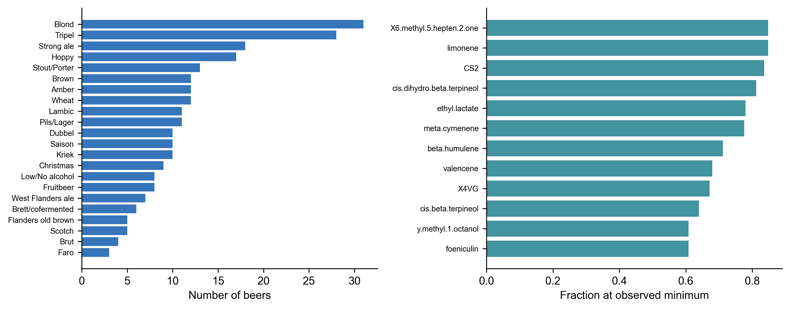

# 五、问题一模型的建立与求解

## 5.1 面板监督目标定义

原始评分既提供 0—6 的实际量表，也揭示了评分员差异和细分项继承规则。直接对 50 个目标独立回归会放弃该结构，但共同叶节点的多输出树本身也能保持线性不等式。因此，结构模型的价值必须以误差和个体评分建模证据检验，不能以“存在层次”直接推出深度网络优越。

对酒 i、评分员 r、重复次 t 的记录 y，目标为先在 t 内平均、再在 r 间平均。Ridge、PLS、RF、ET、HGB 对这一面板目标训练；结构网络对逐记录似然训练，权重为同酒评分员数与该评分员重复次数的乘积倒数，使每款酒等权。测试以未见啤酒的面板均分为单位，既不把 2197 条当成 2197 款独立样本，也不把评分员身份用于推断测试酒真实分数。

## 5.2 模型结构与对照设置

传统基线包括训练均值、Ridge（alpha=10/100）、PLS（5/12 成分）、RF 与 ET [4]（180 棵树，叶最小样本 2，特征比例 0.7）、HGB（每目标 80 轮、7 叶、L2=10）。每个候选的训练与内层验证过程均独立执行。MLP 为 231→64→32→50，ReLU 和 0.15 Dropout；训练至多 160 轮，AdamW 学习率 0.002、权重衰减 0.001。

层次网络采用同一编码器，对 26 个直接强度预测七级概率 p(k|x)，对 24 个细分项预测条件勾选概率 q(k,x)。子项期望为 sum[k p(k|x) q(k,x)]，不能用两个边际期望相乘。子项出现损失只在父项强度大于零的记录上计算。加入评分员的版本在父项七级 logits 上添加中心化评分员效应，预测时使用零中心效应；这一估计对应平均 logits 的参考评分员，而不严格等同于全部评分员概率的平均，是该版本需进一步改进的估计目标差异。

MLP、Hierarchy、HierarchyRater 的可训练参数分别为 18578、28478、31390。训练曲线与参数配置均保存。结构网络不是原论文的复现模型；未在本轮增加图神经网络，因为现有任务的样本量与机制证据尚不足以支持额外图模块。

## 5.3 模型求解与性能检验

下表为两次完整 OOF 预测各自计算指标后取均值；MAE/RMSE 单位均为原始评分分值，R² 为 50 目标等权平均。

| model | MAE | RMSE | R2 | AF_MAE |
| --- | --- | --- | --- | --- |
| ET | 0.4454 | 0.6305 | 0.2530 | 0.5089 |
| RF | 0.4502 | 0.6354 | 0.2447 | 0.5132 |
| InnerSelected | 0.4521 | 0.6472 | 0.2101 | 0.5155 |
| HGB | 0.4588 | 0.6475 | 0.2169 | 0.5325 |
| HierarchyRater | 0.4690 | 0.6766 | 0.1385 | 0.5367 |
| Hierarchy | 0.4751 | 0.6754 | 0.1381 | 0.5369 |
| PLS | 0.4818 | 0.7024 | 0.0729 | 0.5521 |
| Ridge | 0.4833 | 0.7022 | -0.0082 | 0.5494 |
| MLP | 0.5240 | 0.8082 | -0.2752 | 0.5816 |
| Mean | 0.5488 | 0.7634 | -0.0069 | 0.6044 |

观察到的最低 MAE 方法为 ET，MAE=0.4454，重复划分标准差=0.0020。预先规定的内层模型选择流程 InnerSelected 的 MAE=0.4521、RMSE=0.6472、R²=0.2101。观察到某模型排名第一与预先冻结选择流程的测试表现应分别表述，不能用全体 OOF 结果再选模型后声称其评估完全独立。

配对统计以每款酒的两次 OOF 平均预测为基础，与 InnerSelected 比较，用 2000 次啤酒级 bootstrap 计算差值区间，并对 Wilcoxon 检验作 Holm 校正；它评价的是重复 OOF 集成，与上表单次误差均值略有不同。各目标误差见 per_target.csv，不能用总体均值掩盖弱目标。

| comparator | positive_favors_reference | CI_low | CI_high | p_holm |
| --- | --- | --- | --- | --- |
| Mean | 0.1064 | 0.0938 | 0.1191 | 0.0000 |
| Ridge | 0.0310 | 0.0185 | 0.0461 | 0.0000 |
| PLS | 0.0264 | 0.0161 | 0.0400 | 0.0000 |
| RF | 0.0059 | 0.0001 | 0.0114 | 0.0278 |
| ET | 0.0010 | -0.0043 | 0.0059 | 0.2874 |
| HGB | 0.0054 | -0.0011 | 0.0119 | 0.0287 |
| MLP | 0.0660 | 0.0370 | 0.1067 | 0.0000 |
| Hierarchy | 0.0199 | 0.0136 | 0.0265 | 0.0000 |
| HierarchyRater | 0.0134 | 0.0079 | 0.0192 | 0.0001 |

## 5.4 评分卡等级输出

将预测的连续面板均分裁剪到[0,6]后采用$\widehat g=\lfloor\widehat y+0.5
floor$形成0—6整数等级。等级一致率指预测等级与真实面板均分舍入等级的一致，而非某位评分员的个体等级。输出表同时保留连续预测、等级及两项乙醛无监督状态。

## 5.5 敏感性与适用范围

| experiment | MAE |
| --- | --- |
| ET_equal_rater | 0.4452 |
| ET_mask_0.05 | 0.4487 |
| ET_mask_0.1 | 0.4539 |
| ET_mask_0.2 | 0.4605 |
| ET_official_Z_scale | 0.3413 |
| ET_record_training_equal_eval | 0.4455 |
| ET_without_barnyard | 0.4502 |

额外遮蔽 5%、10%、20% 输入只施加在测试特征，使用训练中位数处理，模拟随机缺失；它不代表真实非随机检测失败。重复评分权重和去除 barnyard 的敏感性结果用于判断数据语义选择的影响。面板均分的区间由评分员重采样获得，是有限评分员测量不确定性，不是模型预测区间。输出的全样本 ET 模型用于后续展示性画像，不能用其对训练数据的拟合分数代替 OOF 成绩。

证据：outputs/rebuild/q1/fold_metrics.csv、repeat_metrics.csv、training_curves.csv、sensitivity.csv、panel_uncertainty.csv。旧网页版的 AF30 MAE=0.5062 对应不同标签权重与五折划分，不与本轮数字直接作超越声明。

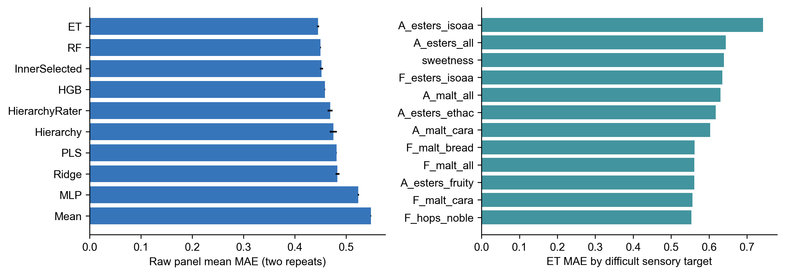

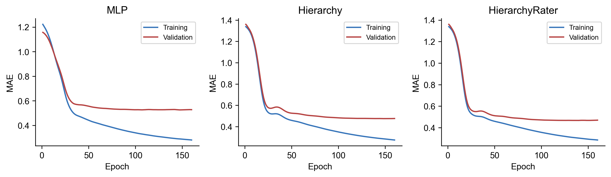

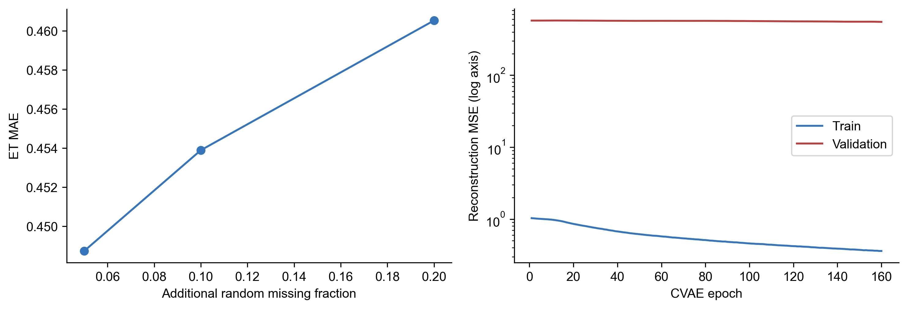

## 5.6 本问小结

以等权面板均分为目标，ExtraTrees在本次内部交叉验证中获得最低观察MAE 0.4454。层次神经网络相对普通MLP有所改善，但未超过树集成。评分结构有助于明确预测语义，不能由此推导深度模型必然占优。以上误差只代表内部啤酒级划分，不能称为未知新批次的外部性能。

# 六、问题二模型的建立与求解

## 6.1 候选集与有符号共表达网络

单变量相关前三经常重复表达同一组发酵或酒花信号。把三项相关性当成三种独立机制，会放大候选因素的解释力度；直接改用条件选择又可能因有限样本残差而产生更不稳定的排名。因此，本问同时评价预测、冗余与重采样稳定性，并将“选择哪一种规则”的过程纳入训练数据内部。最终任务输出固定为每个感官三项，而不将低频变量包装成稳定的唯一因素。

候选集中剔除颜色、pH、压力、聚合总量等13项非单一分子测量，保留218个可识别化合物候选。完整预测任务仍可使用所有231项；两种特征口径不能混淆。共表达图节点为231项测量变量，附件2的Spearman绝对值达到0.65时连边，符号与绝对值分别保留。该图只作全样本描述，不作为外层测试的训练先验；相关定义和名称映射已经在原始数据上数值复核。

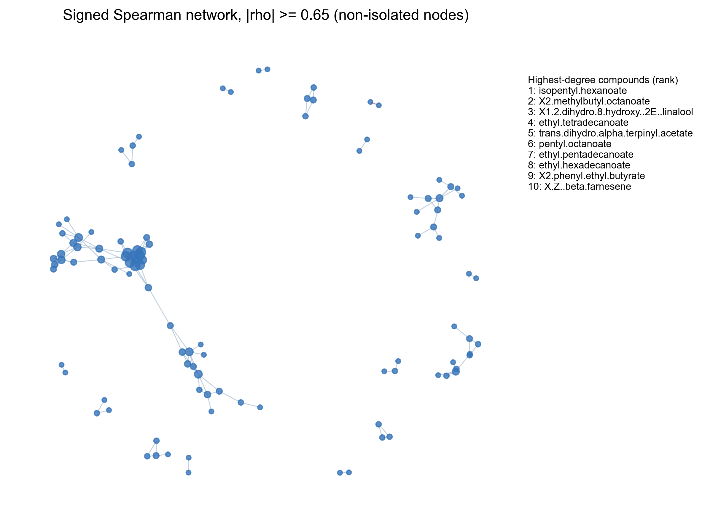

## 6.2 四种筛选规则与条件增益

设训练秩变换后的特征矩阵为 $Z$，各列中心化并归一化，目标秩向量为 $t$。Spearman规则按 $|z_j^Tt|$ 取前三；2+1规则先取相关前二，再条件选第三；Forward3在三步均更新条件残差；冗余控制规则在每步用目标相关减去0.5倍与已选特征的最大绝对相关。

对已选集合 $S$，令 $H_S=Z_S(Z_S^TZ_S+0.02I)^{-1}Z_S^T$，构造 $u_j=(I-H_S)z_j$ 与 $r=(I-H_S)t$。在这个正则残差空间，单变量问题的最优增益为

$$\min_b\{\|r-bu_j\|^2+0.02b^2\},\qquad G_j=\frac{(u_j^Tr)^2}{u_j^Tu_j+0.02}.$$

每一步选择未入选变量中 $G_j$ 最大者。这里的“完整前向”指三个步骤都条件更新；由于 $H_S$ 不是幂等投影，该分数是所定义辅助残差问题的增益，不能声称精确求解所有三变量组合或原始联合Ridge的全局最优。2+1与Forward3采用相同的条件分数，差别仅在前两步。

四种规则选择后，均用相同的三个附件编码特征、训练中位数和训练标准化，拟合alpha=8的Ridge。它们拥有相同预测器和变量数，避免把选择规则与预测模型复杂度混在一起。

## 6.3 训练内选择与外层评价

沿用原两次三折啤酒级外层划分。每个外层训练集内部，按既有20%划分计算四方法的50目标等权MAE，确定一种规则，然后在完整外层训练集上重新选择三变量并拟合；外层酒样只用于评价。最终全样本模型重用同一内部选择算法，再全量重拟合。外层所有候选成绩均保留，最终规则的选择不使用其外层分数。

下表先对每次完整OOF预测计算指标，再报告两次结果的均值与标准差；它修正了按不等大小折直接平均的汇总口径。真实监督是评分员等权原始均分，MAE与标准化附件4的旧误差不可直接横比。

| 方法 | MAE均值 | MAE标准差 | RMSE | R² |
| --- | --- | --- | --- | --- |
| Forward3 | 0.5038 | 0.0045 | 0.7124 | 0.0983 |
| 2+1 | 0.4988 | 0.0012 | 0.7029 | 0.1155 |
| 冗余控制 | 0.4996 | 0.0019 | 0.7046 | 0.1107 |
| Spearman | 0.5021 | 0.0025 | 0.7065 | 0.1117 |
| 训练内选法 | 0.5024 | 0.0058 | 0.7093 | 0.1031 |

最终全训练数据内部选择为2+1，故正式50×3表、分子名称、选择得分、入选率与替代组指标统一来自该规则。训练内选法流程的外层MAE为0.5024，固定2+1的OOF MAE为0.4988。前者没有获得额外预测收益，说明小样本内层选择具有方差；不能用全量内部选出的2+1替代训练内选法的外层成绩。配对检验先平均同款酒的两次OOF预测，再按酒计算误差，与表中逐次误差均值的口径不同。检验与啤酒bootstrap区间见closed/q2/paired_tests.csv，没有据测试结果再设新的加权规则。

## 6.4 Bootstrap稳定性与替代组

100次Bootstrap在各风格内按酒重采样，填补、缩放和选择全部重做。重复抽到的同款酒被整体放入同一内层角色，避免其副本跨越内层训练与验证。固定规则频率回答“给定规则时分子是否稳定”；训练内选法频率还包含规则本身变化。最终150行同时保存两种频率，避免以固定规则频率代替完整流程的不确定性。

替代组沿用描述性完全链接分组：组内各对的绝对Spearman至少0.8。它用于衡量相近测量是否可替代，不参与外层特征选择。每个目标用相同的100对Bootstrap集合计算单分子及替代组Jaccard，并同时记录三因素内部绝对相关。

| 方法 | 单分子Jaccard | 替代组Jaccard | 三因素平均绝对相关 |
| --- | --- | --- | --- |
| Forward3 | 0.1787 | 0.1860 | 0.1535 |
| 2+1 | 0.2288 | 0.2354 | 0.2740 |
| 冗余控制 | 0.2020 | 0.2102 | 0.1368 |
| Spearman | 0.2827 | 0.2929 | 0.4385 |
| 训练内选法 | 0.2057 | 0.2141 | 0.2740 |

内部规则的Bootstrap选择次数如下。规则切换本身是小样本不确定性的结果，不据此继续增加规则或调节惩罚系数。

| 规则 | 次数 |
| --- | --- |
| 冗余控制 | 30 |
| Spearman | 27 |
| 2+1 | 24 |
| Forward3 | 19 |

## 6.5 50×3输出与化学合理性

表中保留原始Spearman、风格内去均值后的秩关联、标签疑点以及来源/单位。后者是混杂敏感性指标，不是已识别的因果效应；风格也可能代表真实发酵过程，调整后关联变化需结合过程解释。高度相关的酯和高级醇可能共同反映发酵条件，不能简单将排名逐一解释为独立作用。原论文通过真实添加实验验证部分候选[1]，本工程尚未开展这一步。

最终表不以“化学常识”手工替换统计结果。高频主因素、同组可替代项和低频候选分别解释；barnyard保留疑似公式别名标记。每一项的名称、频率、方向和风格调整变化见统一CSV与逐维解释报告，供队员独立作化学复核。

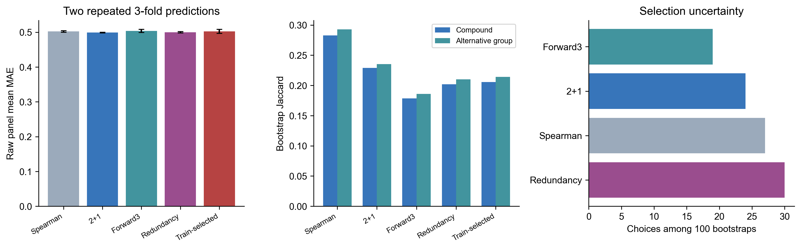

## 6.6 本问小结

固定2+1在本次候选规则中达到较低预测MAE，但单分子稳定性低于Spearman。完整训练内方法选择流程未带来进一步改进。最终150条结果应被视为可复核的关联候选，并结合替代组频率、风格控制和已有化学证据解释，不宣称为已证实的独立致因物质。

# 七、问题三模型的建立与求解

## 7.1 任务形式化与交付对象

给定细分风格$s$，条件生成目标是在当前附件编码空间中抽样化学谱$x\sim p(x\mid s)$。生成结果须保留231个字段及其尺度说明，并通过已冻结的Q1感官预测器生成50维感官画像。跨风格迁移进一步给定来源谱$x_0$和目标风格$s^*$，寻找兼顾目标特征、改动幅度和指定缺陷限制的候选$x'$。三项交付分别为风格化学谱、预测感官画像和逐酒迁移审计。

## 7.2 风格条件生成模型

每种风格仅3至31款，无法支持各自独立估计231维联合分布。直接连续生成又难以保留大量相同最小值。采用总体信息共享可以降低方差，却可能削弱风格边界；分布距离变小也可能来自生成谱向均值收缩。本轮将这种取舍作为待验证问题，比较已有四模型，参数与训练角色全部冻结。

PCA高斯使用12维潜变量、风格均值收缩和共享协方差，输出限制在训练范围。独立Copula与联合Copula共享收缩条件边际：

$$\widehat F_{j,s}=w_s\widehat F_{j,s}^{\mathrm{empirical}}+(1-w_s)\widehat F_{j,all},\qquad w_s=\frac{n_s}{n_s+10}.$$

对稀有风格，较大的总体权重控制经验分布方差。联合Copula将训练秩变换成正态分数，用Ledoit–Wolf收缩估计相关矩阵[5]，通过 $z\sim N(0,\widehat R)$、$x_j=\widehat F_{j,s}^{-1}(\Phi(z_j))$ 采样。独立消融令相关矩阵为单位阵，检验联合依赖的贡献。经验逆分布的区间自然保留最小值点质量，不需要后续逐列随机替换；模型并未识别最低值以下的真实浓度。

CVAE沿用231维输入、22类条件、64维隐层、12维潜变量和KL系数0.05，最多160轮，以原35款验证酒的重构误差选检查点[6]。四模型不增加训练轮数、结构或超参数搜索。

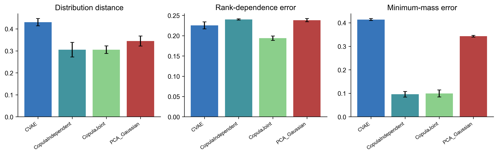

## 7.3 生成谱对应的感官画像

仅有化学谱还未完成官方第三问。对Tripel、Kriek、Lambic等指定风格，生成器先在231维附件编码空间内采样，再使用第一问冻结的全样本展示用ExtraTrees映射为50维连续感官画像，并按评分卡规则生成0—6等级。用于画像的评分器训练与Q1误差评价相互区分：全样本评分器可对生成谱做展示性预测，但不能把它在训练酒上的拟合结果当成新的折外验证成绩。

图示应选择具有代表性的Aroma、Flavour及缺陷相关维度，展示各风格的平均画像和生成样本间变异；完整50维谱保存在`outputs/rebuild/q3/generated_sensory50.csv`。这些画像属于模型预期感受，需要真实品评验证，不能写成生成样品已经具备的实际风味。

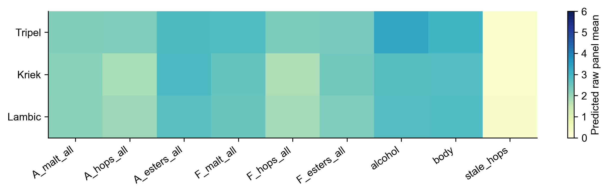

## 7.4 逐风格生成评价

三个原始场景均保留140款生成训练酒、35款验证酒、40款独立评价器训练酒与35款测试酒。对每个场景的每种风格生成40条谱，共计算22×4×3=264行指标。四模型共享按场景与风格固定的采样种子、48个投影方向和训练尺度。风格分类器使用原迁移评价器的既有ET配置，在独立40款酒上拟合并保存；其输出只用于评价，不参与模型或样本筛选。

对测试风格分布计算边际Wasserstein与切片Wasserstein距离。相关结构使用真实和四模型共同可计算的Spearman变量对；测试样本少于4款时不估计该项。令 $B_j(x)=1\{x_j\le m_j^{train}\}$，其中 $m_j^{train}$ 为训练最小值，仅对训练中低端比例至少25%的变量评价。联合最低值模式用各变量对的 $E[B_jB_k]$ 绝对误差衡量，同时报告单变量低端质量误差。这里的“低端”是观测编码阈值，不是已知仪器LOD。

最近邻距离、完整复制比例和标准化多样性均在最终输出谱上计算。零完整复制只能排除逐行原样复制，不能证明经验边际没有训练信息记忆。风格分类器的输出分数也没有概率校准，应解释为模型诊断分数。

## 7.5 生成结果与指标权衡

原划分中20/22种风格有独立测试酒；Faro与Flanders old brown为零。相关结构仅4/22种风格在至少一个场景满足样本数条件，共7个风格场景。两类缺口在表格和热图中保留NA，不能用验证酒、训练酒或生成样本补成测试证据。完整22风格覆盖表及88行分模型汇总见附录。

下表先在每个风格内跨场景平均，再对有定义的风格等权平均；分类一致性覆盖全部22种风格，分布和联合低端误差覆盖20种，相关误差只覆盖4种。各列支持集合不同，因此必须按列比较同指标，不能把它们合成未预设的总分。

| 模型 | 条件SWD | 风格一致性 | 相关误差 | 联合低端误差 |
| --- | --- | --- | --- | --- |
| CVAE | 0.7059 | 0.0917 | 0.4608 | 0.1896 |
| 独立Copula | 0.8676 | 0.1409 | 0.4669 | 0.2260 |
| 联合Copula | 0.8637 | 0.1356 | 0.4508 | 0.2288 |
| PCA高斯 | 0.7516 | 0.0852 | 0.4704 | 0.1887 |

条件尺度结果与旧版混合风格总体距离回答不同问题。CVAE的条件SWD较小，但其平均多样性为0.4202；独立Copula为0.8966。当真实测试风格只有一两款时，收缩到中心可能使经验距离更小，不能据此断言CVAE更真实。最近邻距离、风格一致性和低端质量共同揭示这种取舍。

联合Copula相关误差为0.4508，独立Copula为0.4669，改善范围限于可估计场景；联合低端误差分别为0.2288和0.2260，未显示联合模型的统一优势。共享一个总体依赖矩阵不能自动恢复每类风格特有的低端共现关系。

生产生成器和迁移生成器继续沿用此前验证集选定结果，未依据此次条件测试成绩改选。Tripel、Kriek、Lambic画像及22风格880条谱仍保留为展示输出；生成模型的统计接近不构成真实酿造可行性证据。

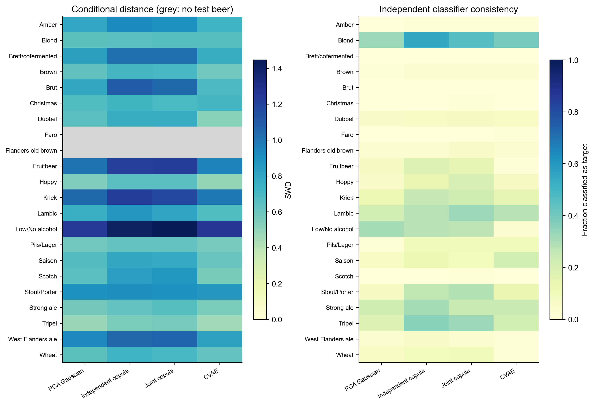

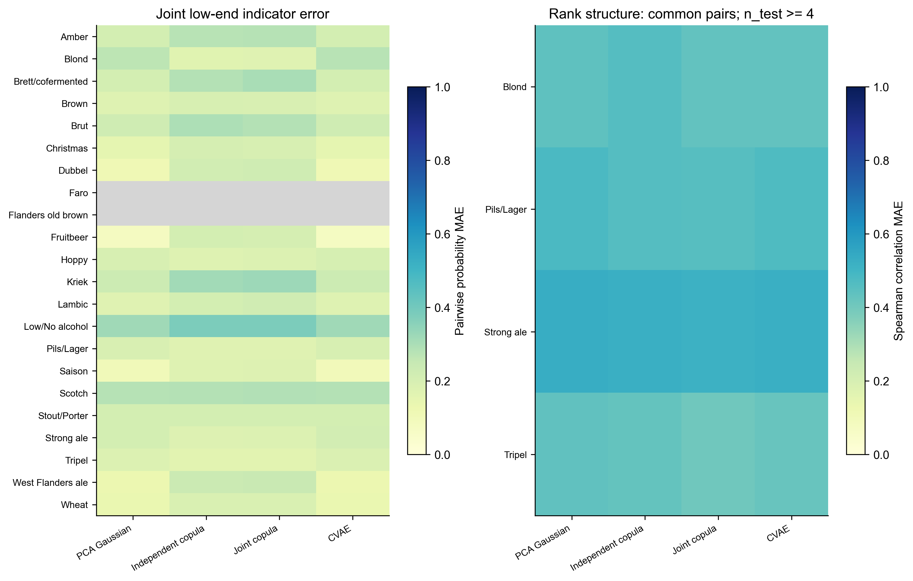

## 7.6 跨风格迁移决策模型

跨风格迁移同时追求目标接近与缺陷不恶化。若同一个感官预测器既筛选候选又证明安全，优化器容易利用其误差。本实验固定原始9款不同Pils源酒，每款只保留其最早符合条件的原测试场景，避免重复计数。源酒不属于相应生成训练、验证或评价器训练角色。三个场景的独立评价器在优化前序列化，其文件哈希在所有策略完成后保持不变。

每个源生成80条Tripel候选，再以0.25、0.5、0.75、1.0插值形成320条迁移谱，加入原谱作为第321个候选。四策略共用候选、设计预测器、尺度和成本；固定的拒绝策略直接返回原谱。对候选 $x'$，成本为

$$J(x')=\|T(x')-\mu_{Tripel}\|_2+0.15\|T(x')-T(x)\|_2,$$

其中 $T$ 为生成训练集标准化，目标中心来自同一批Tripel候选。独立风格分类分数不进入这个成本。

无约束策略选择最低成本。点约束与不确定性约束先将四个明确化学标记裁剪至不高于源编码，再用12个仅在生成训练集拟合的Bootstrap ET计算stale_hops预测差。点约束要求平均差不大于零；不确定性约束要求90%分位差不大于零。保留原谱保证候选集合存在可行返回；返回原谱计为拒绝迁移。该分位没有经覆盖率校准，是模型集成风险筛查，不是90%置信安全保证。

所有策略的选择完成后，才读取独立评价器，对源谱与最终谱统一评分。评价器包括固定ET分类器、感官回归器和在相同独立40款酒上构造的12个Bootstrap回归器。评价器的集成差分位用于检验设计风险能否迁移，不反馈到选择过程。

## 7.7 风格收益与独立缺陷风险

目标收益为独立分类器Tripel分数之差；缺陷风险同时报告stale_hops均分变化、上升酒数和独立集成90%分位。化学RMS为按生成训练尺度标准化的231维改变量。下表以全部9款为分母，包含被拒绝酒的零收益，避免只在接受子集上展示效果。

| 策略 | 目标收益 | stale变化 | stale上升率 | 化学RMS | 拒绝率 |
| --- | --- | --- | --- | --- | --- |
| 无约束 | 0.0514 | -0.0094 | 0.6667 | 0.6191 | 0.0000 |
| 点约束 | 0.0514 | -0.0241 | 0.5556 | 0.6096 | 0.0000 |
| 不确定性约束 | 0.0289 | 0.0052 | 0.4444 | 0.5231 | 0.2222 |
| 拒绝迁移 | 0.0000 | -0.0000 | 0.0000 | 0.0000 | 1.0000 |

点约束带来平均目标分数收益0.0514，其独立stale_hops均值变化为-0.0241，但仍有5/9款上升。平均下降与个体风险并不矛盾，说明仅报告均值会掩盖失败样本。不确定性约束拒绝2/9款，全部源酒的平均目标收益降为0.0289，仍有4/9款上升；在实际接受的7款中对应4/7。因而本次证据不支持“更保守的设计约束必然带来独立缺陷改善”。

拒绝迁移的收益与改变量为零，拒绝率100%，提供明确的决策下界。它不能作为实现目标风格的成功，但在缺少可靠安全证据时是可陈述的保守输出。本轮未通过观察独立评价器后新增拒绝阈值，也未把拒绝策略改造成反馈优化器。

## 7.8 统计检验与适用边界

2000次配对Bootstrap按9款不同源酒重采样，区间条件于固定训练场景与固定评价器，不包含重新训练的不确定性。Wilcoxon检验对三种实际迁移与拒绝的两类收益/缺陷差分别组成6项比较，再作Holm校正。

| 策略 | 指标 | 均值差 | Holm校正p |
| --- | --- | --- | --- |
| 点约束 | target_gain | 0.0514 | 0.0469 |
| 点约束 | stale_change | -0.0241 | 1.0000 |
| 不确定性约束 | target_gain | 0.0289 | 0.3125 |
| 不确定性约束 | stale_change | 0.0052 | 1.0000 |
| 无约束 | target_gain | 0.0514 | 0.0469 |
| 无约束 | stale_change | -0.0094 | 1.0000 |

点约束与无约束的目标分数收益在本次内部检验中通过0.05的Holm门槛；三个实际迁移策略的stale变化均没有通过。小样本条件下不能把未拒绝零假设解释为缺陷等效或安全。

DMS、Diacetyl、4VG、trans-2-nonenal分别核对附件列名和变换。前三项同时列出平均及中位感官阈值，trans-2-nonenal和stale_hops没有完整可用阈值时记NA。感官检测阈值不等于跨风格通用的不可接受界限。对于四个有观测化学编码，约束策略的增加次数为零；源缺失值和低于/位于训练最小值的标记保留“物理不可验证”，不据裁剪宣称真实浓度顺序。stale_hops使用独立感官代理，不能换算成唯一化合物浓度。

逐酒原谱角色、评价器哈希、选中候选编号、接受/拒绝、五类缺陷检查及单位表均保存。统计生成和迁移结果仍需要真实样品添加与盲评才能验证工艺和感官可行性。

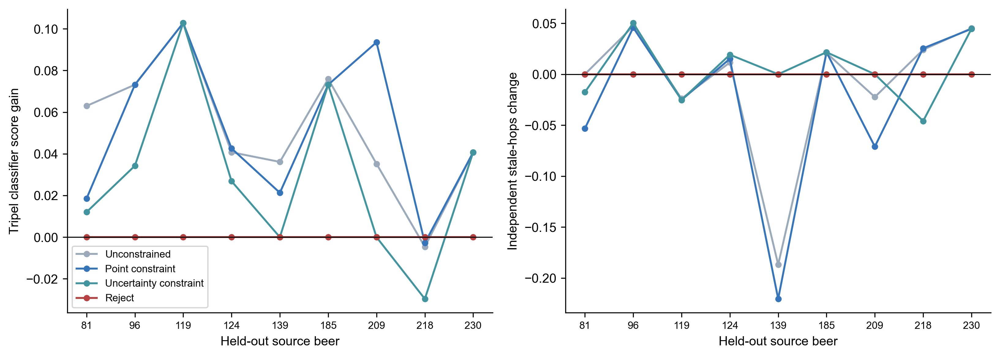

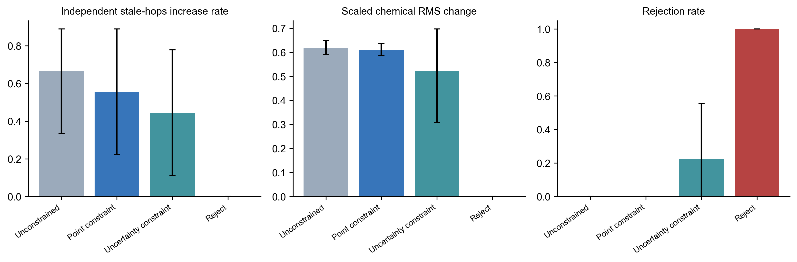

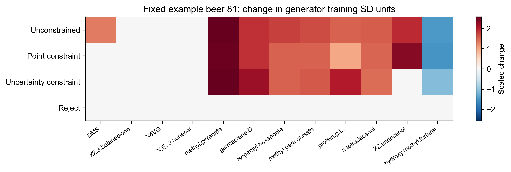

## 7.9 本问小结

四类生成模型各有指标优势，现有证据不支持单一模型在全部风格上全面领先。迁移实验可以量化风格接近度与缺陷代理风险的取舍，但独立代理仍出现上升，故“编码空间不增”不能表述为真实风味缺陷零恶化。保留原谱是本方法明确提供的可执行决策选项。

# 八、模型检验与综合评价

## 8.1 三问研究结果的一致性

第一问将公开逐评分员记录映射为连续面板均分，同时提供0—6整数等级和监督缺失标记；第二问在相同啤酒样本与化学名称口径下寻找稀疏关联候选；第三问生成附件编码空间的化学谱，并通过冻结的Q1模型映射为感官画像。三问共用的主要对象是231项化学编码、250款样本与风格标签，而不是完全相同的评价目标。第一、二问面向有监督评分，第三问以条件分布及风险决策为中心。各问结果文件、随机种子、指标计算和图表脚本在封闭工程中保存，可由输出清单逐项回溯。

不能简单把Q2的Top-3解释结果直接当成Q3迁移的化学干预处方。Q2排名来自观察相关和预测贡献，尚缺乏在新配方中的外部干预验证。同样，Q3中的目标风格分类器与缺陷感官回归器具有有限准确性，无法提供物理生产安全的保证。

## 8.2 消融实验支持与未支持的假设

第一问的层次网络优于普通MLP，但仍不及ExtraTrees，说明根据评分机制设计网络具有实际动机，却未成为更好的最终预测器。第二问固定2+1相对Spearman减少一部分预测误差，同时丧失部分排名稳定性；完整内层选法的外层误差没有下降，说明在250款酒上为选择规则再设自动择优步骤存在可观方差。

第三问的联合Copula在可估计风格的相关结构误差方面优于独立Copula，但在共同低端模式和条件SWD上没有取得全面优势；CVAE有较小的条件SWD，同时多样性明显不足。迁移中不确定性约束降低了接受比例和平均目标收益，但未实现独立代理上的逐酒零上升。因此全文的贡献应定位为更清楚地处理观测、选择与验证过程，不能以复杂网络或风险阈值的存在本身证明创新有效。

## 8.3 证据边界

本研究的所有模型开发均围绕同批250款啤酒，重复划分仍属于内部重采样。原论文的原始评分记录与赛题化学数据覆盖同一批酒，不能当成额外未知外部测试集。22种风格中仅20种具有分布距离的测试支持，相关结构估计仅少量风格有足够样本。最低值堆积不等于已知仪器LOD；barnyard与stale_hops的标签来源存在疑点；stale_hops的独立评价仍依赖有限样本训练的感官代理。没有真实化学添加、发酵和盲评实验，结论只能限定在观察数据和代理评估层面。

# 九、结论与建议

## 9.1 主要结论

（1）在原论文公开的2197条评分员记录基础上，先评分员内、后评分员间等权建立250款啤酒的感官监督目标，避免重复评分放大部分样本权重。对50个有监督维度，ExtraTrees在两次三折内部交叉验证中取得MAE 0.4454、RMSE 0.6305，优于同协议下比较的层次网络。

（2）对50个感官属性，提出按Spearman保留两项并通过正则条件增益补充第三项的固定2+1筛选规则。其内部交叉验证MAE为0.4988；包含内层方法选择步骤的完整流程MAE为0.5024。150条化合物候选均提供方向、频率和可替代组信息，不能据此判定因果作用。

（3）对22种风格比较四类条件生成器。CVAE在有测试支持风格的SWD为0.7059，但多样性较低；联合Copula的相关结构误差0.4508优于独立Copula的0.4669，且优势不扩展到所有指标。由此，生成器选型需要结合风格支持样本量和多种分布指标。

（4）在9款独立来源Pils酒的Tripel迁移实验中，点约束获得平均目标风格诊断收益0.0514，但独立stale_hops代理仍有5款上升。不确定性约束拒绝2款后收益下降至0.0289，仍有4款上升。当前结果说明约束需要独立复核，不能将自有代理满足条件写成实际缺陷风险消除。

## 9.2 对酿造实践的建议

对于预测评分误差较小且Bootstrap入选频率较高的化合物，可作为后续单因素添加实验的优先考察对象；对高度共线的候选，应以成组比较代替直接判定某一种物质是独立致因因素。对于风格迁移，应先利用模型生成候选的化学变化范围，再在真实发酵条件和感官品评中检验风格贴近度及缺陷指标。若来源化学值缺失、阈值无可核查依据或不同风险评价器意见冲突，应保留原方案，并将原因记录于实验报告。

## 9.3 局限与后续验证

本研究的主要限制是风格稀疏、部分字段的物理浓度映射不完整，以及同批历史啤酒样本无法提供独立外部泛化证据。后续若取得新批次啤酒，应在完全锁定模型后进行外部评分验证；生成与迁移部分需要真实添加、酿造或盲评实验。此前提不满足时，论文只能报告统计预测、关联筛选和代理迁移结果。

# 参考文献

[1] Schreurs M, Piampongsant S, Roncoroni M, et al. Predicting and improving complex beer flavor through machine learning. Nature Communications, 15:2368, 2024. DOI: 10.1038/s41467-024-46346-0.

[2] Schreurs M, et al. Data from: Predicting and improving complex beer flavor through machine learning, version v4. Zenodo, https://zenodo.org/records/23624915, 访问日期 2026-10-28.

[3] MathorCup 组委会. 2026 年 MathorCup 大数据挑战赛赛道 A 初赛题、论文格式及提交规范、人工智能工具使用规定（试行）. 本地官方附件, 2026.

[4] Geurts P, Ernst D, Wehenkel L. Extremely randomized trees. Machine Learning, 63:3–42, 2006. DOI: 10.1007/s10994-006-6226-1.

[5] Ledoit O, Wolf M. A well-conditioned estimator for large-dimensional covariance matrices. Journal of Multivariate Analysis, 88(2):365–411, 2004. DOI: 10.1016/S0047-259X(03)00096-4.

[6] Kingma D P, Welling M. Auto-Encoding Variational Bayes. arXiv:1312.6114, 2013, https://arxiv.org/abs/1312.6114, 访问日期 2026-10-28.

[7] OpenAI Codex，GPT-6系列及gpt-6.1-sol，OpenAI，2026-10-28。用于审计、代码、实验、统计、图表与论文辅助。

# AI工具使用声明（草稿，须与真实队员记录核对）

本工程及本稿使用OpenAI Codex，历史GPT-6系列及本轮gpt-6.1-sol[7]，辅助数据核验、模型实现、实验运行、统计、可视化、论文和排版。本轮严格执行三组封闭补充，Q1输出与源程序哈希保持冻结，三组完成后停止建模探索。程序头部、图表说明和支撑材料均标明AI参与。

官方规定要求核心建模、算法设计、求解与分析由参赛队员独立完成。当前没有可核实的队员独立核心工作或人工修改记录，本稿如实保留该状态；单纯审阅签字不能替代独立完成。队员须独立开展并记录关键工作后决定正式采用内容。详细说明、关键交互摘要与待完成记录位于AI工具使用详情说明.pdf、AI_usage_log.md和human_decision_record.csv。
